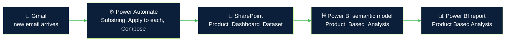

  

 

> [!IMPORTANT]
> **All data in this repository is synthetic.** Every figure, country ranking and chart in the screenshots was generated for confidentiality reasons and does not represent real OCP Group data.

 

<h2 align="center">🚀 Overview</h2>

This project is my final-year project (PFE) at **OCP Group, SBU Rock Solutions (Casablanca)**, completed for my engineering degree at EMSI between March and June 2026. The goal was to build a complete decision-support pipeline for the global phosphate trade market, from raw trade data to a dashboard that analysts can explore and refresh on their own.

| Component | What it does |
|---|---|
| **Predictive model** | Partial equilibrium model in Python (bisection method), backtested on 15 years of trade data |
| **Data warehouse** | Star and snowflake schemas, loaded through SSIS ETL pipelines |
| **Power BI dashboard** | Interactive analysis with custom DAX measures and automated data refresh |
| **Refresh automation** | Power Automate flow that drops incoming data files into SharePoint for Power BI Service |
| **AI agent** | Conversational assistant built with Flask and Groq (Llama 3.3-70B) to query the data in natural language |

This README walks through four parts of the project, each with a screenshot: the dashboard, the data model, the automation flow and the refresh setup in Power BI Service. The model performance figures I report (MAE of about 5% against a published benchmark of about 12%) come from the original project, not from the synthetic data used here.

 

<h2 align="center">📊 The Dashboard</h2>

  The "Product Based Analysis" page (synthetic data)

 

The dashboard is a single page designed to answer one question quickly: who trades which phosphate product with whom, and how has that changed over time? Products are DAP (diammonium phosphate), MAP (monoammonium phosphate), TSP (triple superphosphate), phosphate rock and sulphur.

### Header and refresh
The top banner holds the report title, a **Refresh Data** button and a date stamp (13/05/2026) that matches the last refresh recorded in Power BI Service (see the Automated Data Refresh section below).

### KPI cards
Six cards compare the current period with the previous one:

| Card | Value shown |
|---|---|
| Volume Current Periods | 243.657K |
| Volume Previous Periods | 416K |
| Top Current Importers | France |
| Top Previous Importers | Brazil |
| Top Current Exporters | Egypt |
| Top Previous Exporters | Scotland |

### Filter panel
The left panel filters every visual at once: **Year**, **Quarter Name**, **Month Name**, **Products** (DAP, MAP, Phosphate Rock, Sulphur, TSP), **Import Countries** and **Export Countries**.

### Trade Flow
A Sankey diagram links loading countries (10 in this view, on the left) to discharge countries (16, on the right). The width of each band is proportional to the traded volume, so the main trade routes stand out immediately.

### Products Distribution
A line chart of the summed volume per product for 2024, 2025 and 2026, one line per product. It shows which products drive the volume and how their weight shifts from one year to the next.

### Percentage of Imports Per Country
A 100% stacked column chart, one column per year, showing each importing country's share of that year's total volume. It highlights concentration: whether a few importers dominate a given year or the volume is spread out.

 

<h2 align="center">🗄️ The Data Model</h2>

  Snowflake schema of the warehouse

 

The warehouse combines star and snowflake designs. This diagram shows the snowflake version: one central **fact table** (`Trade`) surrounded by five main dimensions, four of which are split further into sub-dimensions.

| Table | Role | Main columns |
|---|---|---|
| `Trade` | Fact | `Trade_Fact_PK`, `Date_Key`, `Country`, `Port_Key`, `Vessel_Key`, `Product_Key`, **`Volume`** (measure) |
| `Dim_Date` | Dimension | `Date_Key`, `Date`, `Year`, `Quarter`, `Month`, `Day_of_week_Key` |
| `Dim_Day_of_Week` | Sub-dimension of `Dim_Date` | `Day_of_week_Key`, `Day_Of_Week` |
| `Dim_Country` | Dimension | `Country_Key`, `Load_Key`, `Discharge_Key` |
| `Dim_Country_Load` | Sub-dimension of `Dim_Country` | `Load_Key`, `Load_Country_Name` |
| `Dim_Country_Discharge` | Sub-dimension of `Dim_Country` | `Discharge_Key`, `Discharge_Country_Name` |
| `Dim_Port` | Dimension | `Port_Key`, `Load_Key`, `Discharge_Key`, `Port_Name` |
| `Dim_Load` | Sub-dimension of `Dim_Port` | `Load_Key`, `Load_Berth` |
| `Dim_Discharge` | Sub-dimension of `Dim_Port` | `Discharge_Key`, `Discharge_Berth` |
| `Dim_Vessel` | Dimension | `Vessel_Key`, `Vessel_Name`, `Vessel_Deadweight` |
| `Dim_Product` | Dimension | `Product_Key`, `Category_Key`, `Estimation_Key` |
| `Dim_Category` | Sub-dimension of `Dim_Product` | `Category_Key`, `Product_Category` |
| `Dim_Estimation` | Sub-dimension of `Dim_Product` | `Estimation_Key`, `Product_Estimation` |

**Design choices worth noting**
- **One measure, many angles.** `Volume` is the single measure in the fact table. Everything else is a way of slicing it: by time, country, port, vessel or product.
- **Origin and destination are modelled explicitly.** Both countries and ports carry a loading side and a discharge side, which is what makes a loading-to-discharge view like the Trade Flow chart possible.
- **Hierarchies are normalised.** Splitting the day of the week, the country sides, the berths and the product category and estimation into their own tables keeps each attribute stored once.

These are the same business dimensions the dashboard filters on: date, country, product and volume.

 

<h2 align="center">⚙️ Automated Data Refresh</h2>

The dashboard stays up to date without manual file handling. New data arrives by email, a Power Automate flow saves it to SharePoint, and Power BI Service refreshes the report from there.

### Step 1: the Power Automate flow

  
  A successful run of the flow

 

| Step | Action | Time |
|---|---|---|
| 1 | **When a new email arrives** (Gmail trigger) | 0s |
| 2 | **Substring** extracts the part of the email content the flow needs | 0s |
| 3 | **Apply to each** loops over the items to process (1 of 1 in this run) | 2s |
| 4 | **Compose** prepares the file content | 0s |
| 5 | **Create file** (SharePoint) saves the result in the `Product_Dashboard_Dataset` folder, here as `DAP.xlsx` | 1s |

The run banner confirms that the whole flow ran successfully, in a few seconds.

### Step 2: refresh in Power BI Service

  
  Lineage view in Power BI Service

 

The lineage view shows two setups side by side:

| Setup | Source | Semantic model | Last refresh |
|---|---|---|---|
| **Excel with a gateway** | Four workbooks (`TSP`, `MAP`, `DAP` and `Sulphur Exports`), each shown as connected to its data source through a gateway | `Product_Based_Analysis_Dashbo…` | 12/05/26, 21:51 (flagged with a warning icon) |
| **SharePoint** | The SharePoint folder fed by the Power Automate flow | `Product_Based_Analysis` | 13/05/26, 15:24 |

Each semantic model feeds its own report. The SharePoint-based setup is the one behind the dashboard shown above: its report is named `Product_Based_Analysis`, and its refresh date matches the date stamp in the dashboard header.

 

<h2 align="center">🎯 What This Project Demonstrates</h2>

- **Dimensional modelling:** star and snowflake schemas designed around a single measure.
- **ETL:** SSIS pipelines feeding the warehouse.
- **BI development:** a Power BI report with DAX measures, a Sankey flow view and cross-filtering slicers.
- **Automation:** an email-triggered Power Automate flow and a refreshable semantic model in Power BI Service.
- **Applied AI:** a conversational agent on top of the data, and a predictive model for the market.

 

<h2 align="center">📬 Author</h2>

**Hasna Elotmani**, Computer Engineer (MIAGE), EMSI

